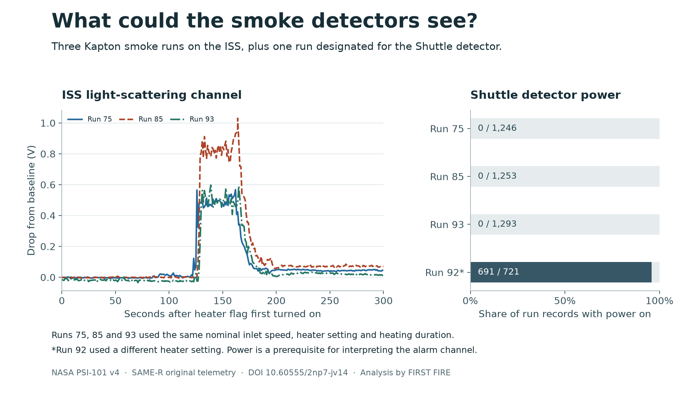

# FIRST FIRE at NASA Space Apps 2026

**Decision brief for Code Blooded · Amaravati · 15 November 2026**

Lead with **Best Use of Science**. Give a judge one NASA comparison, let them change an assumption, and show exactly why the research decision changes. **Best Use of Data** is the second strong fit. The 2026 guide says the executive committee nominates teams for “one of ten Global Awards.” NASA named ten different winners in each of the 2023, 2024 and 2025 results. Impact, creativity, validity, relevance and presentation are each scored from 1 to 5 throughout judging. [2026 judging guide](https://www.spaceappschallenge.org/resources/judging-awards-guide/#phase-3-executive-judging) · [2025 winners](https://www.nasa.gov/learning-resources/stem-engagement-at-nasa/nasa-announces-2025-international-space-apps-challenge-global-winners/) · [2024 winners](https://www.nasa.gov/learning-resources/stem-engagement-at-nasa/nasa-international-space-apps-challenge-announces-2024-global-winners/) · [2023 winners](https://science.nasa.gov/directorates/smd/2023-nasa-international-space-apps-challenge-announces-10-global-winners/)

## What to do on submission day

**Update after publication, 15 November 2026:** Version 7 is live. A fresh, signed-out Chrome session reproduced both signed FLEX differences, revealed the run 92 power flags and downloaded the evidence JSON. The public guided session, transport lab, payload test request, JAXA wire case, six slides and Telugu classroom case all opened. The public offline ZIP was byte-for-byte identical to the tested local copy. This resolves the earlier route failures recorded below. The team reports that nobody has tried FIRST FIRE yet; local adoption, learning outcomes and external validation remain unmeasured. The team owner still needs to submit the official form. [Judges’ demo](https://first-fire-lunar-lab.christsamuel26.chatgpt.site/demo.html) · [Submission text and links](../../research/submission.md)

| Priority | Action | Evidence of completion |
| --- | --- | --- |
| 1 · Public project | Align the submitted URL with the version being pitched. On the morning of 15 November, an unauthenticated Chrome session opened the SIBAL case, but the public guided session and the FLEX, transport and design labs each rendered **Page not found**. All four opened from the local distribution. The public six-slide demo loaded. | Open the intended final URL in a fresh browser, carry one case through to an exported result, and inspect its NASA source. Until a hosted build passes, use the working public SIBAL case and six-slide demo for the presentation. [Working SIBAL case](https://first-fire-lunar-lab.christsamuel26.chatgpt.site/#case/sibal) · [Public six-slide demo](https://first-fire-lunar-lab.christsamuel26.chatgpt.site/demo.html) · [Guided route checked](https://first-fire-lunar-lab.christsamuel26.chatgpt.site/#session) |
| 2 · Science demonstration | Show the FLEX result below. Have the judge tighten one control, then open the underlying rows. If the four public routes are still missing, the live SIBAL case already shows that slower spread can accompany longer burning. | A second person can reproduce the selected rows, sign change, and disappearance of the comparison, or locate the two distinct SIBAL endpoints in the NASA presentation. [FLEX methods](../../research/advanced-methods.md) · [NASA LUCI comparison, pp. 33–34](https://ntrs.nasa.gov/api/citations/20250010653/downloads/ASGSR%202025-LUCI-Ferkul-Presentation-v2-20250010653.pdf#page=33) |
| 3 · Evidence of impact | Use the project's existing masked evaluation with independent readers in Amaravati. The team protocol already supports six unpublished cases and a matched six-reader pilot. If only a short usability observation is possible, report its actual task, participant count and outcome. | A participant can identify the right source row, the condition that limits the claim, and the next measurement. Report failures, timeouts and time alongside success. Team rehearsals and software benchmarks measure different things. [Evaluation protocol](../../research/evaluation.md) |
| 4 · Submission | Use the six-slide demonstration or a video of at most 30 seconds. The limit for a deck is seven slides total. Make both submitted links public, credit NASA PSI, and disclose SI/AI assistance and generated imagery as the guide specifies. | The team owner sees the official submission confirmation before **11:59 p.m. IST on Sunday, 15 November**, assuming the owner remains registered at Amaravati. A local copy or hosted site alone does not establish submission. [Submission guide](https://www.spaceappschallenge.org/resources/project-submission-guide/) · [Amaravati event](https://www.spaceappschallenge.org/2026/local-events/amaravati/) · [Timezone guidance](https://github.com/nasa/spaceapps/discussions/1916) |

If time permits before submission, use the [five-minute first-observation sheet](first-observation.md) with one volunteer. This is a usability observation; the six-reader comparison remains the appropriate protocol for evaluating performance.

## A demonstration the project can run now

**Does increasing oxygen make a methanol droplet burn longer?** In the local FLEX comparator, select 15% versus 21% oxygen, 14.7 psia, nominal orbital gravity, and the default diluent settings. Lock the comparison before looking at burn durations. For a maximum initial diameter difference of 0.35 mm, three matched pairs give higher-minus-lower differences of −4.8, −3.3 and +12.9 seconds. Their mean is **+1.6 seconds**. At **0.05 mm**, only one pair survives and its difference is **−3.3 seconds**. Requiring both runs to come from the same day leaves **zero pairs** at all five tested diameter tolerances. The sign depends on the matching rule. The archive can tell a researcher why to repeat both oxygen levels on the same day with matched droplets. [NASA FLEX dataset](https://doi.org/10.60555/mbq8-0451) · [Five-tolerance replay and reviewed code](github-research.md) · [Local method](../../research/advanced-methods.md)

Thirty-second narration for a version that exposes the comparison publicly:

> We’re Code Blooded. Does more oxygen make a droplet burn longer in orbit? Three matched NASA flight pairs suggest 1.6 seconds longer on average. Match the starting diameters more closely and the only remaining pair burns 3.3 seconds less. Require the same test day and no pair survives. FIRST FIRE shows which measurements changed the answer and which experiment to run next.

Use one central question in the pitch. The longer project description can distinguish **1,622 nonempty source rows across 15 challenge investigations** from **1,058 normalized observations across nine investigations**. Neither denominator is a count of independent fires. For the updated research chat, the local project records **22/24** on a new first-attempt question set and **24/24** after fixing and replaying the same questions. One first-attempt error returned 604 records from the wider archive for a follow-up whose correct subgroup contained 112 heptane runs. A reader can verify the difference directly. [Data audit](../../research/data.md) · [Question sets, source counts and transcripts](../../research/science-chat-audit.md)

## New flight evidence for the detector case

**Could a quiet Shuttle alarm identify a missed detection?** NASA's SAME-R table explicitly calls Kapton runs 85 and 93 repeats of run 75. All three list 8.1 cm/s inlet velocity, 1.43 for the heater resistance ratio and 60 seconds of nominal heating. The listed net aging times are 32, 33 and 36 seconds respectively, and run 75 is annotated “no Ptrak.” The original workbooks preserve ISS optical scatter voltage and separate Shuttle power, self-test and alarm channels. Filtering on the actual test number changes the denominator because the files also contain other telemetry. [NASA SAME-R investigation and files](https://doi.org/10.60555/2np7-jv14) · [Investigators' detector study](https://pmc.ncbi.nlm.nih.gov/articles/PMC7918997/)

| Run | Shuttle power-on records / records with the test number | Largest ISS scatter drop in first 300 s | Original cell at that peak |
| --- | ---: | ---: | --- |
| 75 | 0 / 1,246 | 0.568 V at 162 s | [W326, NASA workbook](https://psi.nasa.gov/geode-py/ws/studies/PSI-101/download?file=PSI-101_Analyzed+Data_2010_238_18_kapton_run75.xls&version=1&studyVersion=4) |
| 85 | 0 / 1,253 | 1.031 V at 164 s | [W324, NASA workbook](https://psi.nasa.gov/geode-py/ws/studies/PSI-101/download?file=PSI-101_Analyzed+Data_2010_242_12_kapton_run85.xls&version=1&studyVersion=4) |
| 93 | 0 / 1,293 | 0.598 V at 139 s | [W360, NASA workbook](https://psi.nasa.gov/geode-py/ws/studies/PSI-101/download?file=PSI-101_Analyzed+Data_2010_250_13_kapton_run93.xls&version=1&studyVersion=4) |
| 92 · separately designated STS run | 691 / 721 | 2.555 V at 126 s | [W283, NASA workbook](https://psi.nasa.gov/geode-py/ws/studies/PSI-101/download?file=PSI-101_Analyzed+Data_2010_250_16_kapton_run92.xls&version=1&studyVersion=4) |

The Shuttle power and alarm flags were both zero across **3,792** matching records in the three repeats. It would be a scientific error to count three missed alarms. The separate run 92 shows that the power channel can register an on state. Its alarm flag stayed zero and its heater setting differed. Power alone establishes neither detector readiness nor a successful alarm test. A defensible next comparison would require synchronized observations from powered detectors, known sampling and self-test states, matched smoke conditions, and each detector's own alarm criterion. [NASA SAME-R](https://doi.org/10.60555/2np7-jv14) · [Published experiment methods](https://pmc.ncbi.nlm.nih.gov/articles/PMC7918997/)

**Reproduction.** The script fetches four versioned NASA originals and verifies their SHA-256 hashes. It reads the sheet named “Original (cut and paste),” selects the named test, and uses the recorded time of the first active heater sample. Scatter drop is the median voltage in the preceding 30 seconds minus the recorded voltage. The peak is the largest such drop from 0 through 300 seconds. This is an exploratory voltage summary. It measures neither alarm delay nor smoke mass concentration. The source clocks include repeated timestamps and gaps. Preserve the record counts and timestamps. With Python and `xlrd==2.0.2`, run `python replay_same.py --cache ./nasa-cache` from this directory. With Matplotlib installed, add `--figure same-r-kapton.png` to render it. [Replay script](replay_same.py) · [Download figure](same-r-kapton.png)

## Which new sources change the design?

“New” here means newly checked evidence for FIRST FIRE. The NASA telemetry and NIST room experiments predate this hackathon. JAXA published the wire-flame result in 2026.

| Source | What the team can verify | Change to FIRST FIRE |
| --- | --- | --- |
| NASA SAME/SAME-R consolidated workbook, located through HALO | Across the two flight codes, 154 rows have distinct flight-code/SAME-number pairs. Using an illustrative 2.0 V summary-scatter threshold gives 18/23 Teflon, 20/35 Kapton with a numeric reading and 0/26 lampwick observations below it. At 1.5 V the Teflon count drops to 15. | Show the denominator and threshold sensitivity. Keep the workbook's summary statistic separate from the signed raw-telemetry voltage in the figure above. HALO already publishes the threshold analysis. FIRST FIRE adds the run-level power check before interpreting an alarm. [Original NASA workbook](https://psi.nasa.gov/geode-py/ws/studies/PSI-101/download?file=PSI-101_Analyzed+Data_SAME%2C+SAME-R_Results.xlsx&version=1&studyVersion=4) · [HALO source](https://github.com/MaanavKrishna/HALO-Habitat-Assessment-from-Low-Gravity-Observations/blob/214fe39815f9fb2c43c06d5d2d4764917adcb935/pipeline/halo_pipeline/detector.py) |
| JAXA FLARE-3, June 2026 | In the published wire tests, flames sustained more readily in the rotating chamber than in the nonrotating parabolic-flight setup at the same nominal lunar acceleration. The investigators discuss recirculation and preheating. | Put gravity-generation method, specimen geometry, flow and spread direction in the comparison. A numeric gravity match can still require a different test. Apply this finding to the wire case. Retain the original textile forecast and its timestamp. [JAXA account](https://humans-in-space.jaxa.jp/kibouser/pickout/74526.html) · [Research paper](https://doi.org/10.1016/j.combustflame.2026.114800) |
| NIST room smoke experiments, 90 time series in six source classes | For flaming foam run FFoamG1T1 the summary gives 147 s, obscuration 2.144 %/ft and MIC current 72.788 pA. The raw counter at 147 gives 0.317 %/ft and 96.69 pA. At 207 it gives 2.144 %/ft and 72.79 pA. A second run's 134 s summary matches counter 194 on the two channels. | A researcher who joins on the printed number alone associates the alarm with the wrong readings. Expose the clock origin or mark alignment unresolved. Two matching offsets do not justify applying 60 seconds across the dataset. The terrestrial fire/food-cooking controls support an Earth case with a separate endpoint. [NIST data dictionary](https://www.nist.gov/el/fire/engineered-fire-safety/data-smoke-alarm-performance) · [Raw TSV files](https://www.nist.gov/system/files/documents/2016/12/15/roomdata.zip) · [NIST summary workbook](https://www.nist.gov/system/files/documents/2016/12/14/summary_nistsmokebox_roomresults.xlsx) |
| PSI Flame Design and an external extraction answer key | All 813 mutually numeric FLEX fields agreed within the peer scorer's tolerances on shared NASA inputs. Of 881 entries in the peer's eight-file key, 207 were normal-flame PSI-10 entries that FIRST FIRE held in raw form outside its normalized table. BASS-II's “Air display” entries lack velocity units in the experimental CSV. | Add a focused normal-flame adapter after checking chamber versus burner fields. Test duplicate IDs, extra rows, explicitly approximate values and failed ignition. For BASS-II, display a physical flow only when the applicable day/hardware calibration accompanies it. These checks measure extraction agreement. [External answer key](https://github.com/R-Nour/Flame-Atlas/blob/b54ebae7eed48a55aa17b5f974ce381d5421d43f/data/answer_key.json) · [Recomputed comparison](github-research.md) · [BASS-II calibration notebook](https://github.com/hunter-vz/flame-in-freefall/blob/d42ba4cb420efd3bf4db1f9d8c18969203451888/Flame_in_Freefall.ipynb) |

The terrestrial H2SAFE tracer dataset is a possible later test for Transport Lab. Its July 2026 DOE record describes five releases. At review time the laboratory file host returned 503 and the linked repository returned 404. The raw traces, units and compatibility with the two-compartment model remain unverified. FIRST FIRE's existing measured room-repeat exercise ties a simple copy-the-calibration baseline on its two held-out endpoints. Preserve that result until an independent time-series test supports an improvement. [DOE record](https://www.osti.gov/biblio/17118570) · [Existing transport validation](../../research/advanced-methods.md)

**Campaign matters even within one material.** At the illustrative 2.0 V threshold, the Kapton counts split **0/6** in the original SAME flight and **20/29** in SAME-R. All 20 below-threshold observations came from the reflight. Show that split before letting anyone attribute the pooled count to Kapton alone. The summary workbook combines campaigns. The three individual traces above all come from SAME-R. [NASA source workbook](https://psi.nasa.gov/geode-py/ws/studies/PSI-101/download?file=PSI-101_Analyzed+Data_SAME%2C+SAME-R_Results.xlsx&version=1&studyVersion=4) · [Recalculated denominators](github-research.md)

## How prior winners inform the ten award categories

The ten 2025 winners all supplied both a demonstration link and a final-project link. Eight final links were project sites, one was a GitHub README and one was a Drive folder. SpaceGenes+ made a scientific result traceable to a study. PureFlow made a design decision respond to user input. QUEÑARIS tied a proposed intervention to a named community. These are observations about the submissions. The committee's reasons and the odds for any new entry are unknown. The ranking below is our assessment of FIRST FIRE. [Official 2025 winners and entries](https://www.nasa.gov/learning-resources/stem-engagement-at-nasa/nasa-announces-2025-international-space-apps-challenge-global-winners/) · [Three years of award mappings](past-winners.md)

| 2026 category | Comparable winner | What FIRST FIRE can show or still needs |
| --- | --- | --- |
| **Best Use of Science · lead** | **SpaceGenes+** lets a user inspect a gene change and its study ID. | Change the matching rule, reveal the sign change, inspect the NASA source and propose the next controlled experiment. [SpaceGenes+](https://spacegenes-plus.framer.website/) |
| **Best Use of Data · second** | **Resonant Exoplanets** connects classifications to diagnostic plots and an export. | Show the original signal, the power flag, the eligible-record count and the replay. [Resonant Exoplanets](https://www.spaceappschallenge.org/2025/find-a-team/resonant-exoplanets/?tab=project) |
| Best Mission Concept | **PureFlow** lets crew size and mission duration affect habitat design. | For FM², choose a two-specimen budget. Show how the proposed second oxygen setting changes after the first hypothetical outcome. Keep these scenarios separate from the signed forecasts. [PureFlow](https://www.spaceappschallenge.org/2025/find-a-team/pureflow2/?tab=project) · [Design method](../../research/advanced-methods.md) |
| Best Use of Technology | **Twisters** turns forecasts into risks for a chosen activity window. In 2024 **42 QuakeHeroes** focused signal processing on seismic events. | Score the full visible reply on unseen archive questions. Show the erroneous 604 versus 112 answer and how checking the previous selection catches it. [Twisters](https://www.spaceappschallenge.org/2025/find-a-team/twisters/?tab=project) · [2024 winners](https://www.nasa.gov/learning-resources/stem-engagement-at-nasa/nasa-international-space-apps-challenge-announces-2024-global-winners/) |
| Best Storytelling Award | **HerCode Space** told a solar story through a character; **TerraTales** used regional climate stories in 2024. | Ask whether silence means a detector missed smoke. Show the power channel before revealing the answer. One question can carry the full demonstration. [HerCode Space](https://a-solar-tale.netlify.app/) |
| Galactic Impact | **Astro Sweepers** gives an operator a debris risk report. | Give a payload engineer a test request that identifies the specimen, exposure, endpoint, missing observation and consequence of measuring it. A completed user exercise would support an impact claim. [Astro Sweepers](https://www.spaceappschallenge.org/2025/find-a-team/astro-sweepers-we-catch-what-space-leaves-behind/?tab=project) |
| Local Impact Award | **QUEÑARIS** tied its proposal to water scarcity and reforestation in Arequipa. | Measure whether an Amaravati engineering class or laboratory can find a correct test and cite it faster. Record actual local use before claiming a benefit. [QUEÑARIS](https://www.spaceappschallenge.org/2025/find-a-team/watana-project/?tab=project) |
| Global Connection Award | **Gaia+LEO** connected orbital and terrestrial compute planning. In 2023 **Arcobaleno** used sonification for accessibility. | Ask a second institution to replay one exported evidence record. Show the matched source IDs, its interpretation, and where it disagreed. Cross-site use is unmeasured. [Gaia+LEO](https://github.com/stayingfoolish/gaia-LEO/blob/f299ea512a1524a2041a28e00a2bb4c1fa6acfaf/mip_model.py) · [NASA 2023 winners](https://science.nasa.gov/directorates/smd/2023-nasa-international-space-apps-challenge-announces-10-global-winners/) |
| Art & Technology Award | **Zumorroda-X** made farm decisions playable. | A time-linked trace or flame sequence can let a learner predict what happens, then reveal the recorded signal. Use distinct line styles, labelled axes and a textual equivalent. Tested accessibility would strengthen this claim. [Zumorroda-X](https://henrysfarmadventures.vercel.app/) |
| Most Inspirational | **Photonics Odyssey** connected a satellite-broadband concept to access for underserved people. | Tell the story of a named, consenting learner who used an open NASA experiment to correct an assumption. The team currently has a testable educational concept and no measured learning outcome. [Photonics Odyssey](https://www.spaceappschallenge.org/2025/find-a-team/photonic-force/?tab=project) |

## Where companies already operate

| Organization or product | Publicly documented work | Implication for FIRST FIRE |
| --- | --- | --- |
| Sierra Lobo | FM² investigators identify Sierra Lobo as the experiment hardware engineering contractor. They describe the camera views, oxygen and carbon dioxide measurements, vent/refill sequence and Earth comparisons. | Design the export for a payload test engineer. Include starting oxygen, oxygen at flame-out, the visual endpoint, Earth comparator, and a place to record invalid or absent telemetry. [NASA investigator interview](https://www.nasa.gov/podcasts/houston-we-have-a-podcast/moon-material-flammability/) · [FM² investigation](https://www.nasa.gov/glenn/glenn-expertise-space-exploration/physical-sciences-program/combustion-science/flammability-of-materials-on-the-moon-fm2/) |
| G-SPACE | NASA describes a beta microgravity analytics tool with segmentation and side-by-side video. | A video viewer alone offers limited differentiation. Make each interpreted event traceable to its source, condition, and next physical test. [NASA description](https://science.nasa.gov/biological-physical/making-space-science-data-smarter-inside-the-microgravity-analytics-tool/) |
| Xtralis / VESDA | ASPIRE helps designers configure aspirating smoke-detector pipe networks. | A detection brief should identify the sampling point, transport path, detector technology and the measurement actually recorded. The current tracer simulation cannot specify a certified detector layout. [ASPIRE](https://xtralis.com/product/7/aspire-pipe-network-design-software) |
| WHA International | WHA offers physical oxygen-compatibility testing for materials and components. | A test lab could evaluate a brief comparing specimen geometry, oxygen, pressure and ignition protocol and judge whether the next test is specified well enough to run. This is a proposed evaluator, with no customer relationship established. [WHA testing services](https://wha-international.com/testing/oxygen-compatibility-testing/) |
| Thunderhead Engineering | PyroSim builds fire simulations for NIST's Fire Dynamics Simulator. | Keep the quantitative promise narrow. Independent measurements and a baseline residual are more meaningful than another cabin rendering. [PyroSim](https://www.thunderheadeng.com/pyrosim/) |

## What the repository research covered

**The current challenge review covers 473 distinct public candidates, 466 nonempty trees, seven empty branches and 55,086 eligible text-file occurrences read in full.** This includes four projects discovered only by the event-wide README pass. The two file ledgers account for 67,395 tracked paths at current pinned revisions. Nine additional project snapshots were available only from the previous day. The corpus includes FIRST FIRE itself. [Full-file audit](flame-file-audit.md) · [Four additions and historical coverage](flame-supplement.md)

The broad search enumerated **5,870** distinct public GitHub repositories matching the 2026 event query. Six narrower searches returned **469** names. Combining those with the previous day's challenge inventory gives **483**, including FIRST FIRE and reference projects. There are **6,009 distinct names across the broad and historical challenge inventories** because the lists overlap. These are search candidates. Some are organizer pages, independent references, duplicated team projects or unrelated matches. Public search cannot supply a complete census of private, unindexed or differently described work. [Event-wide inventory](event-repositories.csv) · [Challenge inventory](flame-repositories.csv) · [Queries and exact search dates](github-research.md)

The event-wide pass also screened the full text of **5,623 root READMEs**. For the other 247 no root README was retrieved. Of 336 README matches, 332 were already in the challenge inventory. The four additional spacecraft-combustion projects included FlameScope. Its verification log explicitly records that none of its eleven ranked rows had an independent check. FIRST FIRE could give an independent reviewer one detector claim, have them trace it to the NASA workbook, and publish the result with their permission. [FlameScope verification log](https://github.com/enigmahacker/flamescope/blob/6bdc38fb59318eabda86d24afaf050df9babb5ab/data/verification_log.csv) · [README-level coverage](event-repositories.csv)

The challenge sources show that grouped testing, pre-registered predictions and adaptive experiment selection already exist in public entries. IGNIS Lab even removes shared test conditions when holding out a campaign. A stronger FIRST FIRE claim is that a judge can follow an export to a specific NASA run and see precisely which assumption changes the scientific conclusion. The acquisition ledger and source readings distinguish automated whole-file screening, individual implementation readings, and checked calculations. [IGNIS Lab validation logic](https://github.com/WingManOO7/ignis-lab/blob/95e601c1c8f1433cfb1722a95345360b32b373fd/scripts/experiments/model_search.py#L181-L194) · [Two full project readings](reading-notes.md) · [Additional pinned competitor and winner readings](github-research.md)

For the 469 current challenge-search candidates, **462 had complete default-branch trees and seven were empty**. The static audit enumerated 67,097 tracked paths, read and hash-checked 54,819 eligible text-file occurrences in full, and recorded reasons for excluding 12,278 paths. The text represents 46,669 distinct Git blobs. Of 437 external repositories with a program, notebook or web interface, 335 contained PSI locator strings, 184 contained source-location strings and 41 contained named group-aware split methods. These counts establish what the text contains. The pinned implementation notes explain what specific projects do. No competitor code was executed. [Audit and exclusions](flame-file-audit.md) · [Per-repository coverage](flame-repository-coverage.csv) · [File-by-file ledger, compressed CSV](flame-repository-files.csv.gz)
